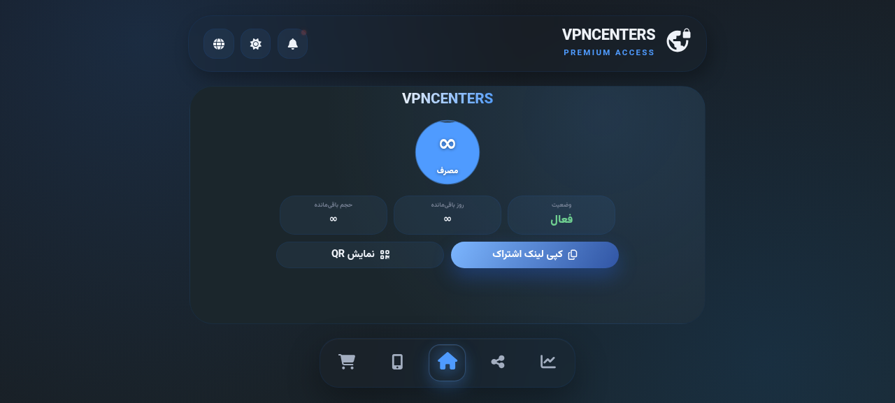
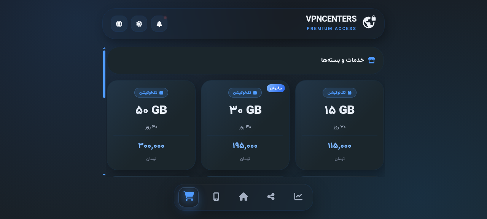
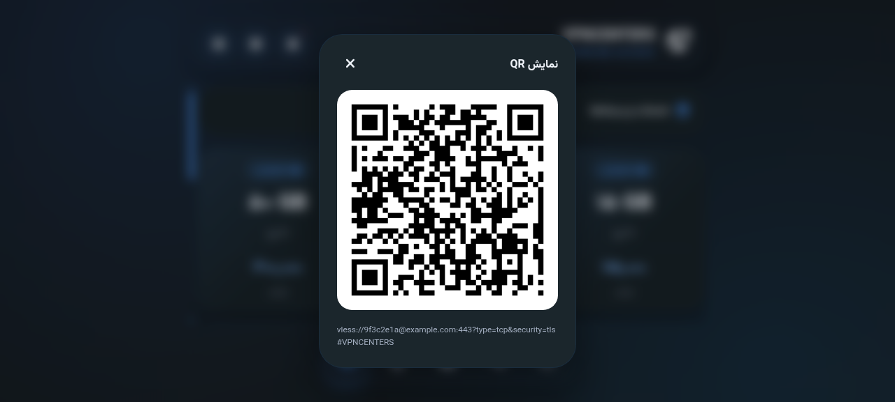

# 📡 VPNCENTERS — قالب صفحه اشتراک 3x-UI

قالب مدرن، تک‌فایل و واکنش‌گرا برای **Subscription Page** پنل 3x-UI، با برند **VPNCENTERS**.

| | |
|---|---|
|  |  |
| صفحه اصلی — مصرف، انقضا، هویت کاربر | خدمات و بسته‌ها — قیمت‌های واقعی |
|  | |
| QR محلی — بدون سرویس خارجی | |

## ✨ ویژگی‌ها

- 🔷 عنوان و برند پیش‌فرض **VPNCENTERS** (در صورت خالی بودن `subTitle` پنل)
- 🤝 لینک پشتیبانی: [t.me/master_supports](https://t.me/master_supports) (با اولویت `subSupportUrl` پنل)
- 📦 بسته‌های واقعی: تک‌لوکیشن (۱۵ تا ۱۰۰ گیگ) و مولتی‌لوکیشن ۲۵ کشور (۱۰ تا ۳۰ گیگ)
- 📱 QR کاملاً **محلی** (کتابخانه MIT داخل فایل) — بدون وابستگی به `api.qrserver.com`
- 🎨 آیکون PWA و favicon داخلی (SVG) — بدون فایل‌های جانبی
- 🧹 بدون ردپای محیط‌های آنلاین تست و بدون لینک‌های شکسته
- 🌗 حالت تاریک/روشن، زبان فارسی/انگلیسی، نصب PWA

## 🚀 نصب

1. فایل `sub.html` را در مسیر تم پنل 3x-UI کپی کنید.
2. در تنظیمات پنل (`Settings → Sub`) مسیر این تم را مشخص کنید.
3. `subTitle` و `subSupportUrl` را در پنل خالی بگذارید تا مقادیر پیشفرض برند استفاده شود، یا مقدار دلخواه بدهید.

## 📝 نکات

- لینک اشتراک هر کاربر از طریق `{{ .subUrl }}` و کانفیگ‌ها از `{{ .links }}` توسط خود پنل تزریق می‌شوند.

## 📄 License

MIT © 2026 frank0live

---

© VPNCENTERS
